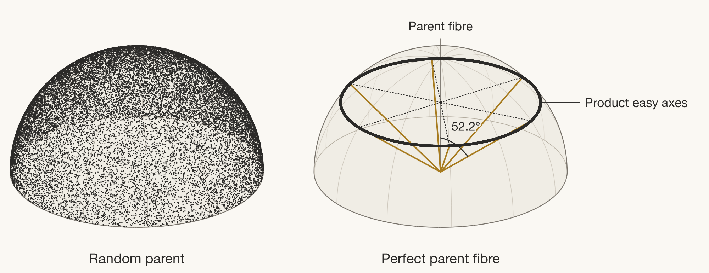
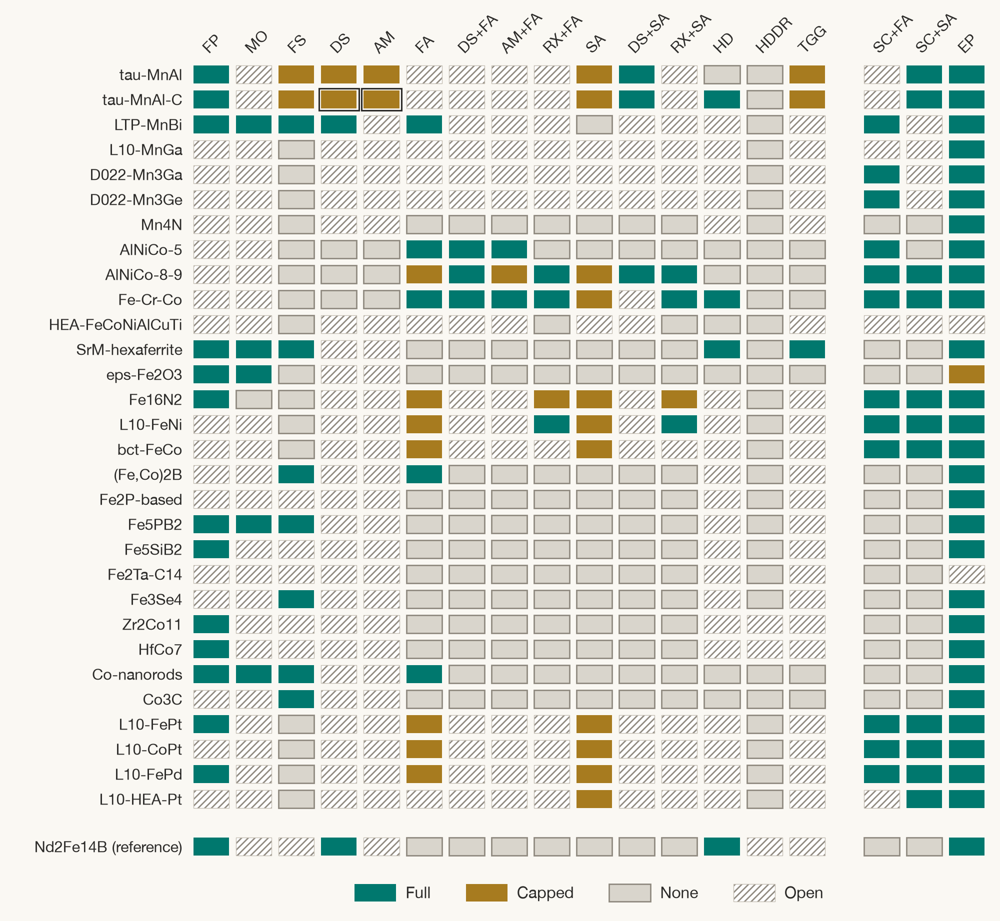
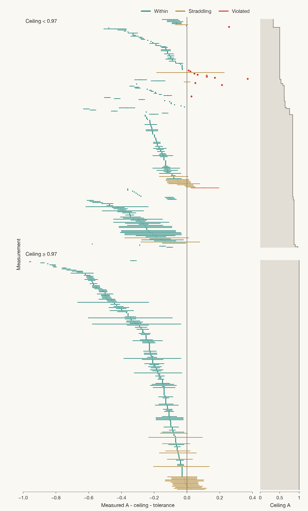

# A textured parent need not make an aligned magnet

Permanent magnets without rare earths lose remanence, the magnetisation left after saturation, when their grains' easy axes fail to line up. This NumPy orientation engine uses cited crystal structures, transformations and magnetic properties to assess which manufacturing routes can align the grains.

**In printed MnAl(C), even perfect parent texture gives a computed alignment ceiling of 0.61, against 0.50 for random grains.** Across **558 phase and route combinations**, the [account](results/account.csv) gives a ceiling, mechanism and measurement that could refute it, and names the missing input wherever the verdict is open.

The six product variants put their easy axes at 52.2° to the parent's fibre. Perfect parent texture concentrates them on a ring, leaving the pole empty.

The cap assumes equal variant populations and no bias. [Routes that select variants or orient the hard phase](docs/method.md#routes-beyond-the-mnal-c-cap) offer ways beyond it.

## Find the mechanism and the test

The account spans 31 phases across 18 routes, including Nd2Fe14B as a rare-earth reference. The rare-earth-free subset contains 540 combinations.

| Verdict | Combinations | Meaning |
|---|---:|---|
| Full | 103 | Alignment of at least 0.95 is allowed |
| Capped | 30 | Variant geometry limits alignment |
| None | 196 | The route supplies no alignment gain |
| Open | 229 | A named unpublished quantity decides |

Of the full cells, 51 concern films or single-crystal parents and four belong to the Nd2Fe14B reference; these physical ceilings are not bulk manufacturing recipes. Every open cell names the missing quantity, alternative outcomes and deciding measurement.

Atlas route key

| Code | Meaning |
|---|---|
| FP | Field pressing of powder |
| MO | Shape orientation of single-crystal particles |
| FS | Field orientation of crystals in a melt |
| DS | Directional solidification |
| AM | Additive manufacturing |
| FA | Field annealing or field bias during formation |
| RX | Rolled or recrystallised parent |
| SA | Stress annealing or stress bias during transformation |
| HD | Hot deformation |
| HDDR | Hydrogenation, disproportionation, desorption and recombination |
| TGG | Templated grain growth |
| SC | Single-crystal parent |
| EP | Epitaxy (films) |

A `+` combines the parent preparation with field or stress bias. The [route definitions](docs/method.md#routes) give the prerequisites.

## Test the ceiling against measurements

**394 of 441 held-out measurements stayed within the frozen v1 ceilings: 89.3%.** Another 34 straddled the limit after conversion uncertainty; 13 clearly exceeded it.

Each row shows a measurement interval relative to its ceiling plus tolerance; zero is the tested boundary. The strip at right shows that row's ceiling, with a gap separating the restrictive and high ceilings.

A passing result tests an upper bound; 221 measurements had ceilings of at least 0.97, which remanence ratios rarely exceed. The [validation record](docs/validation.md) separates the more restrictive ceilings, exclusions and failures.

| Frozen rules | Fresh measurements | Within | Straddling | Violated |
|---|---:|---:|---:|---:|
| v2 | 4 | 4 | 0 | 0 |
| v3 | 89 | 89 | 0 | 0 |
| v4 | 40 | 34 | 4 | 2 |
| v5 | 60 | 60 | 0 | 0 |

Each revision was held out only on a later batch. Correcting v3's missing same-sample saturation values produced one exceedance associated with exchange enhancement; earlier-batch rescoring remains post hoc.

## Assumptions made

- Alignment is the volume-weighted mean absolute projection of the easy axes. It equals the remanence ratio for saturated, non-interacting uniaxial grains.
- Routes operate at their physical best. Exchange enhancement is excluded; coercivity, cost and manufacturing yield are not predicted.
- Missing physical inputs remain conditional. The [method](docs/method.md) and [evidence rules](docs/data.md) define the limits.

## How to use it

**Load** [account.csv](results/account.csv) to compare routes, then follow its record IDs into [data](data/README.md). **Run** the tests and regenerate the numbers using [REPRODUCE.md](REPRODUCE.md). **Port** the [orientation operators](src/align/README.md) to your phase using a sourced structure, transformation and easy axis. **Free to use:** the code, curation, text and figures are dedicated under [CC0 1.0](LICENSE); cited publications and dependencies retain their own terms.
