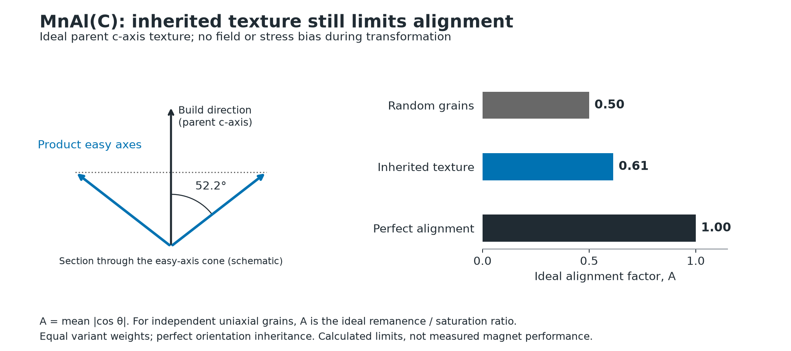
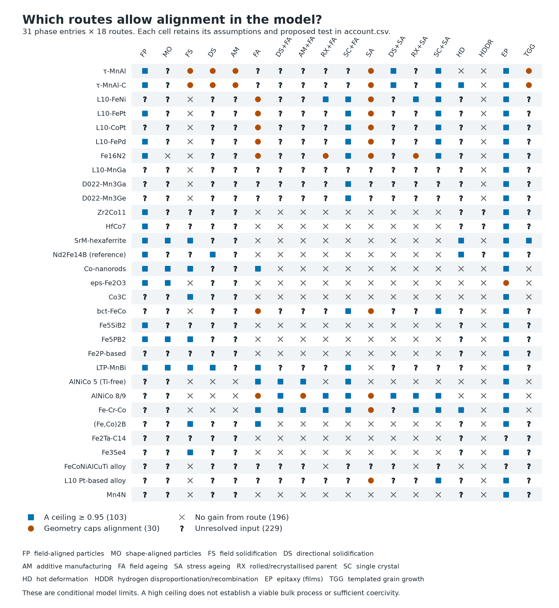
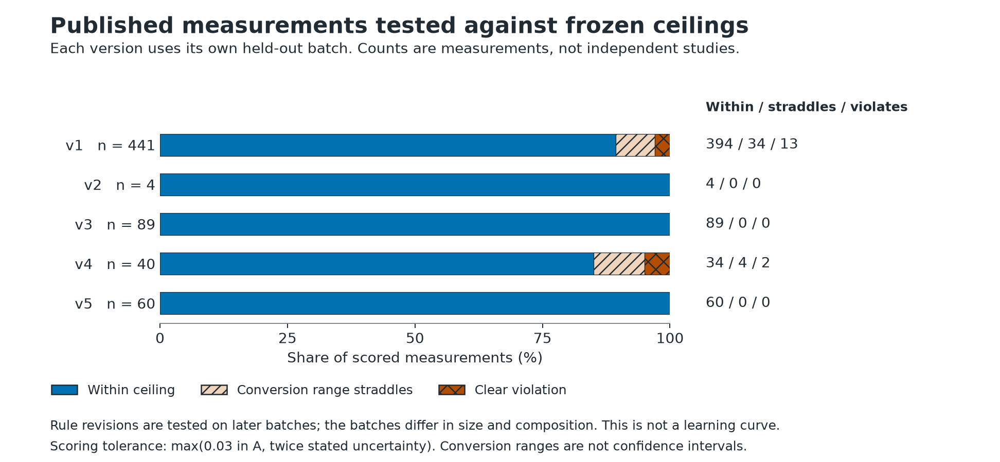

# Rare-earth-free magnet alignment



**A textured parent need not make an aligned magnet.** For the printed MnAl(C) texture, even perfect orientation inheritance gives an ideal remanence-to-saturation ratio of about 0.61. This assumes equal variant populations and no field or stress bias. [Calculation and assumptions](results/account.csv).

This project models how processing sets magnetic alignment across 31 phase entries and 18 routes, using published crystal structures, transformations and magnetic properties. It calculates conditional ceilings and identifies measurements that could refute them. It does not predict coercivity, cost or a working manufacturing process.



Each cell has its mechanism, assumptions and proposed test in the [data table](results/account.csv). A square means the model permits an alignment factor of at least 0.95 under ideal conditions. Some routes concern films or single crystals. The [findings](FINDINGS.md) carry the details.



These checks ask whether published measurements exceed a frozen ceiling. Passing does not establish an accurate point prediction. The [report](REPORT.md) includes failures, conversion corrections and results after rule changes. [Scoring data](results/) and [method](docs/METHOD.md).

## Reproduce

```sh
python3 -m venv .venv
.venv/bin/pip install numpy==2.4.6 PyYAML==6.0.3 matplotlib==3.11.1
.venv/bin/python tools/make_figures.py
```

The figures read the committed result files. Run `./regenerate.sh` to rebuild the results and reports from the source records. Figure inputs, hashes and transformations are in [provenance.json](figures/provenance.json). [SVG figures](figures/) are also included.
