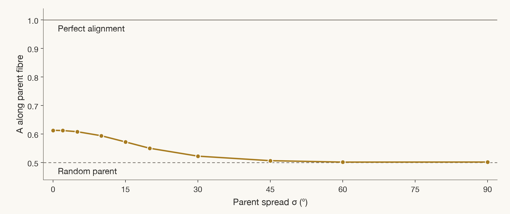

# What the ceiling means

The useful question is whether a route has a way to align the hard phase, and what survives when the starting crystal transforms. The account evaluates each route at its physical best. A low ceiling can rule out alignment by that mechanism; a high ceiling still needs a process that reaches it.

## Alignment and remanence

For easy-axis unit vectors $`\hat e_i`$, volume weights $`w_i`$ summing to unity and magnet axis $`\hat z`$:

```math
A(\hat z)=\sum_i w_i\left|\hat e_i\cdot\hat z\right|,
\qquad B_r=J_s\phi A.
```

Here $`J_s`$ is saturation polarisation and $`\phi`$ is the hard-phase volume fraction, including dilution by pores or binder. For the shape-anisotropy alloys, the sourced polarisation describes the alloy. The equality $`M_r/M_s=A`$ assumes saturation along the measuring axis and independent uniaxial magnetic units.

Random uniaxial grains give $`A=0.50`$ and perfect alignment gives $`A=1`$. A random cubic grain that retains the nearest of its easy directions can have a larger remanence: the positive-anisotropy cubic reference is $`0.8312`$. A coupled precipitate network can likewise retain magnetisation without grain alignment. Read these alternatives in the account's `chain` and `A_alt`; do not interpret every remanence above the uniaxial reference as texture. Exchange enhancement in fine isotropic grains is excluded from this definition of alignment.

The route ceiling $`A_{max}`$ uses perfect texture, complete variant selection wherever a bias can act, and perfect rotation wherever magnetic bodies can turn. The sample ceiling `A_hi` instead uses the reported process and measuring direction. Neither gives coercivity, cost, processing yield or the performance of a finished magnet.

## Orientation operators

The engine represents each crystal orientation by a rotation matrix and a weight. The same operations apply across phases; the phase description supplies the sourced physics.

```text
parent texture -> transformation variants -> formation bias
                                                |
                                                v
alignment A <- easy-axis projections <- free-body rotation
```

| Operation | What it changes | What can prevent alignment |
|---|---|---|
| Texture | Distribution of parent or directly formed hard-phase orientations | Unknown growth direction or deformation texture |
| Transformation | Product variants generated from the orientation relationship and crystal point groups | Several easy-axis directions, twinning or loss of inheritance during massive growth |
| Formation bias | Relative variant populations | No magnetic order at formation, or no coherent transformation strain for stress to select |
| Free-body rotation | Direction of a particle's net anisotropy | Immobility or internal variants with no unique axis |
| Consolidation | Retained hard-phase fraction | Decomposition or destruction of the anisotropic structure |

A field can select a magnetically ordered product, or a ferromagnetic nucleus polarised by an ordered parent. Above the relevant Curie point, estimated susceptibility and nucleus volume bound the paramagnetic bias. Those strength estimates do not set the ceilings. Stress selection requires a coherent transformation with directional strain; complete selection is an ideal limit, not a calculation of the load needed.

For a transformation through an intermediate phase, selection is assessed separately at each step. For a mobile particle containing several variants, the engine rotates its combined anisotropy tensor. A degenerate tensor leaves a set of equivalent directions rather than a unique alignment axis. Along a measuring axis different from the bias axis, an unbiased state can exceed complete selection; the ceiling includes that possibility.

## Routes

| Code | Alignment mechanism |
|---|---|
| FP | Field rotation of powder particles, followed by consolidation |
| MO | Shape orientation of single-crystal particles |
| FS | Rotation of crystals in a melt |
| DS | Directional solidification texture |
| AM | Additive manufacturing texture |
| FA | Field bias during formation or annealing |
| DS+FA, AM+FA | Solidification or printing texture followed by field bias |
| RX+FA, SC+FA | Rolled or recrystallised parent, or single-crystal parent, with field bias |
| SA | Stress bias during transformation |
| DS+SA, RX+SA, SC+SA | Textured or single-crystal parent with stress bias |
| HD | Deformation texture of the hard phase |
| HDDR | Hydrogenation, disproportionation, desorption and recombination |
| EP | Epitaxial orientation in a film |
| TGG | Growth from aligned templates |

EP is a film route. The SC routes assume a single-crystal parent. HDDR needs suitable hydride thermodynamics and orientation memory through recombination. TGG needs template growth within the phase's stability window; when the hard phase forms inside a parent, a template can texture that parent without selecting the product variants.

## Reading a cell

The account contains 558 cells: 31 phases, including the rare-earth reference Nd2Fe14B, across 18 routes. Its 30 rare-earth-free phases contribute 540 cells.

`full` means a mechanism allows $`A_{max}\geq0.95`$; it does not assert that a magnet with that alignment has been made. `capped` means the mechanism acts but geometry keeps the ceiling below that threshold. `none` means no gain beyond the unaligned value or an inapplicable mechanism. For the uniaxial comparison, the numerical no-gain threshold is $`0.50+0.001`$.

`open` means an unpublished input changes the verdict when its alternative values are evaluated. Read `decides` for that input, its alternative ceilings and the measurement that would settle it. The single `A_max` in an open row must not be used as an unconditional promise. Other columns provide the best magnet `axis`, the mechanism `chain`, prerequisites `prereq`, source record IDs `refs`, and a test of the cell's physical claim in `test`.

The `Br_max_T` column combines the alignment ceiling with the sourced polarisation and route-specific phase fraction. A favourable product does not establish coercivity or an achievable dense magnet.

## Why MnAl(C) keeps a cap

A hexagonal epsilon parent with a perfect [0001] fibre still produces six easy-axis variants at 52.2° to that fibre under the published orientation relationship. With equal populations, the best alignment is:

```math
A_{max}=\cos\theta\simeq0.6133,\qquad\theta\simeq52.2^\circ.
```

The AM and DS rows for `tau-MnAl-C` carry this ceiling. If massive growth erases the relationship, the result falls to the random value, 0.50. This is a conditional inheritance calculation, not an assertion that incoherent growth always preserves the relationship. A field or stress that changes variant populations changes the problem.



Even the narrowest parent fibre leaves a geometric cap; broadening the fibre takes alignment towards the random baseline. The dashed line is the random-parent calculation; the upper line is perfect alignment.

The [spread calculation](../figures/data/mnal_c_A_vs_parent_spread.csv) gives alignment along the parent fibre, without a field or stress bias:

| Parent spread, degrees | Alignment along the fibre |
|---:|---:|
| 0 | 0.6133 |
| 5 | 0.6085 |
| 10 | 0.5943 |
| 20 | 0.5505 |
| 30 | 0.5228 |
| 45 | 0.5069 |

The spread is the standard deviation of each Cartesian component of the rotation vector used to broaden the parent orientations. It is not a measured rocking-curve width. These are sampled orientation calculations, not experimental measurements; the small variation near the random baseline at the broadest spreads is sampling variation. A realistic parent texture therefore needs its own measured distribution rather than the perfect-fibre ceiling.

The proposed test is an easy-axis pole figure of MnAl(C) formed from a measured AM or DS parent texture, converted to alignment along its best axis. The account names an exceedance of 0.64 as the refuting threshold. Hot deformation is a different mechanism: the known hot-extruded MnAl-C cases span measured alignment from 0.281 to 0.880, with all 65 measurements below their route ceiling.

## Routes beyond the MnAl-C cap

To exceed 0.6133, change how the product variants are selected or how the hard phase is oriented. The `tau-MnAl-C` rows of [account.csv](../results/account.csv) give these alternatives:

| Route | Ceiling | What must change |
|---|---:|---|
| DS+SA | 0.9721, full | Apply stress during transformation of a directionally solidified parent |
| SC+SA | 0.9998, full | Select variants under stress in a single-crystal parent |
| SA | 0.8988, capped | Select variants under stress in an untextured parent |
| DS+FA, AM+FA, RX+FA | Up to 0.9721, open | Apply an effective field bias while the product forms in a textured parent |
| HD | 1.0, full | Deform the hard phase to orient it |
| FP | 1.0, full | Rotate single-variant powder particles in a field |

Stress selection requires a coherent transformation path with directional strain; the ceiling assumes complete selection and does not specify the required load. Applying stress after an incoherent transformation is not this mechanism. For field selection in printed material, the first deciding measurement is whether the hard phase forms below its 513 K Curie point at a practical rate, measured as phase fraction against time. The account separately leaves paramagnetic bias above the Curie point open pending a susceptibility-anisotropy measurement. RX+FA also depends on the parent texture produced by rolling or recrystallisation.

All these values are physical ceilings, conditional on the account's prerequisites. They establish neither a working printing process nor the survival of the hard phase through consolidation. HD and FP act on the hard phase itself; neither is evidence that sharpening an unbiased printed parent can escape the inheritance cap.
