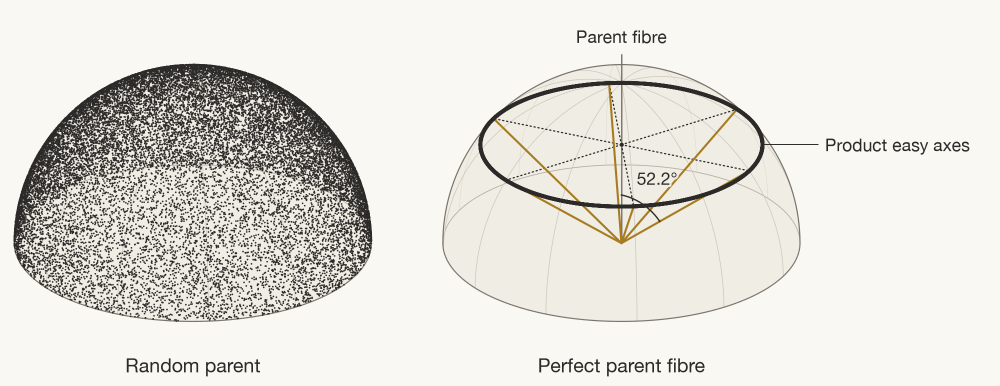

# See where alignment is lost

Perfect parent texture concentrates the product easy axes on a ring at 52.2° to the fibre. With equal variant populations and no bias, their common projection caps alignment at 0.6133.

The [atlas](alignment-atlas.png) shows every phase and route verdict, including the separate Nd2Fe14B reference. Its columns use this route key:

| Code | Meaning |
|---|---|
| FP | Field pressing of powder |
| MO | Shape orientation of single-crystal particles |
| FS | Field orientation of crystals in a melt |
| DS | Directional solidification |
| AM | Additive manufacturing |
| FA | Field annealing or field bias during formation |
| RX | Rolled or recrystallised parent |
| SA | Stress annealing or stress bias during transformation |
| HD | Hot deformation |
| HDDR | Hydrogenation, disproportionation, desorption and recombination |
| TGG | Templated grain growth |
| SC | Single-crystal parent |
| EP | Epitaxy (films) |

A `+` combines the parent preparation with field or stress bias. The [route definitions](../docs/method.md#routes) give the prerequisites.

The [held-out comparison](heldout-ceilings.png) shows every scored v1 held-out interval against its scoring boundary. The [texture-spread curve](mnal-texture-spread.png) shows alignment falling as the parent fibre broadens. All use the included [figure data](data/README.md) or account CSV; [REPRODUCE.md](../REPRODUCE.md) describes regeneration.
